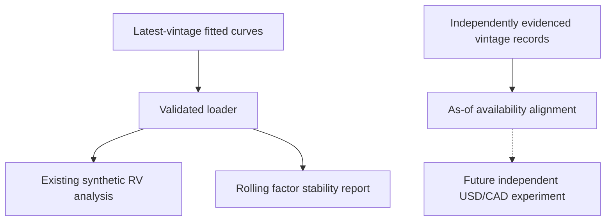

# Research integrity and factor-stability increment

Base inspected: main 1598911. Read README, loader, PCA, fly, signal and both
backtests, regression tests and CI. No open PRs. The old
research/point-in-time-backtest-audit branch diverges and is 48 commits behind;
its earlier three-tenor backtest is already superseded by main's safeguards.
This is a focused audit, not certification of every legacy notebook or cash-bond path.

## Findings and ranking
| Priority | Finding / improvement | Impact | Effort and dependencies |
|---|---|---|---|
| 1 | Observation ordering is not historical public availability | Critical | Machine-readable warnings added to both result summaries |
| 2 | Vintage alignment needs explicit release timestamps and revisions | High | Standalone validated helper added; no fabricated vintage dataset |
| 3 | PCA sign/rank instability obscures comparisons | High | Sign-invariant PC cosines and subspace angles added |
| 4 | Window/regime diagnostics | High | 63/126/252-day report runner and decade summaries added |
| 5 | Genuine investable evaluation | High | Requires historical vintages and executable instrument prices |
| 6 | Independent USD/CAD experiment | High | Not implemented; actual FX/rate sources and timestamp contracts needed |

Existing PCA is fit through each loading date; the fly chooses loadings strictly
before its shock date. Z moments and volatility are shifted; positions use an
observation lag. These mechanisms prevent several row-order leaks but do not
address publication lag or revised source values. Do not globally relabel the
existing backtests as point-in-time. Both now emit
publication_vintages_verified=false and investable_backtest=false.

The availability helper chooses the most recent observation and latest revision
public by each decision. It requires externally evidenced available_at values.
It is intentionally not wired to invented dates for the bundled Fed CSV.
A blanket one-week lag would still not solve revision bias.

## Reproduce
```bash
pip install -r requirements-dev.txt matplotlib
python -m pytest -q
python -m scripts.report_factor_stability --data feds200628.csv --output reports/factor_stability
```
The runner outputs REPORT.md, stability.png, rolling_stability.csv,
regime_summary.csv and metadata.json with source SHA256 and observation window.
CI generates these as an artifact from the actual bundled Fed data.
Consecutive-window stability is influenced by overlap; it is not evidence of
out-of-sample predictive power. Calendar decades are descriptive regimes only.

The existing historical report, negative cost-adjusted finding, DV01 model,
cash-Treasury research, CI and execution blocks remain intact. No parameters
were optimized to reverse the negative finding.

## Architecture


## FX boundary and remaining work
No FX observations, fitted models, predictions or profits are fabricated here.
The requested USD/CAD baseline-versus-PCA experiment remains incomplete.
It needs source-documented FX closes and comparable U.S./Canadian rates,
availability-aware joins, chronological expanding training, scaling fit on
training only, overlapping-label purging for weekly targets, costs/delays,
and untouched holdout comparison. Daily CAD per USD returns must have explicit
quote direction. Latest-vintage fitted Treasury features would still make that
experiment retrospective, even with delayed joins. Keep it separate from all
fixed-income trading modules. EUR/USD is deferred until USD/CAD is completed.

## Resume-safe descriptions
- Added explicit data-availability diagnostics to synthetic Treasury backtests while preserving existing DV01 and execution safeguards.
- Implemented as-of vintage alignment with regression coverage for delayed publication and future revisions.
- Added rolling PCA stability reports across estimation windows and calendar regimes using sign-invariant loading and subspace comparisons.

Local execution was unavailable; verify PR CI artifacts before quoting numerical
stability results. No improvement in predictive performance is claimed.
