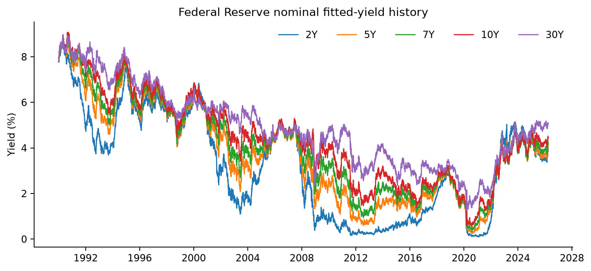
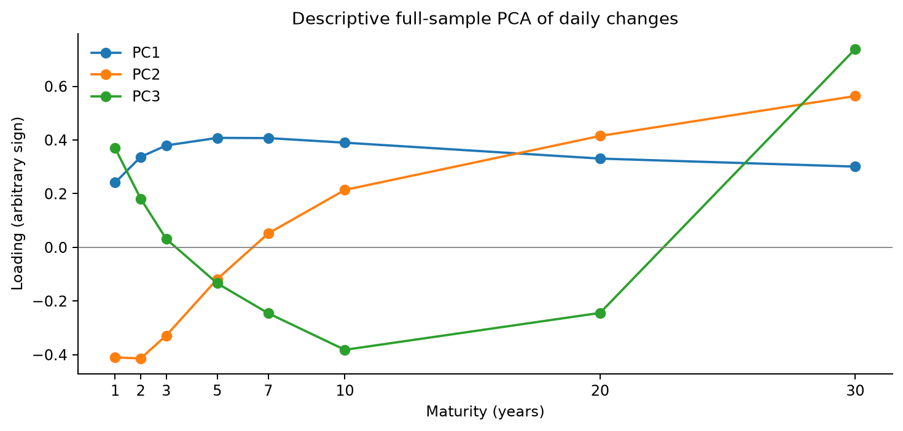
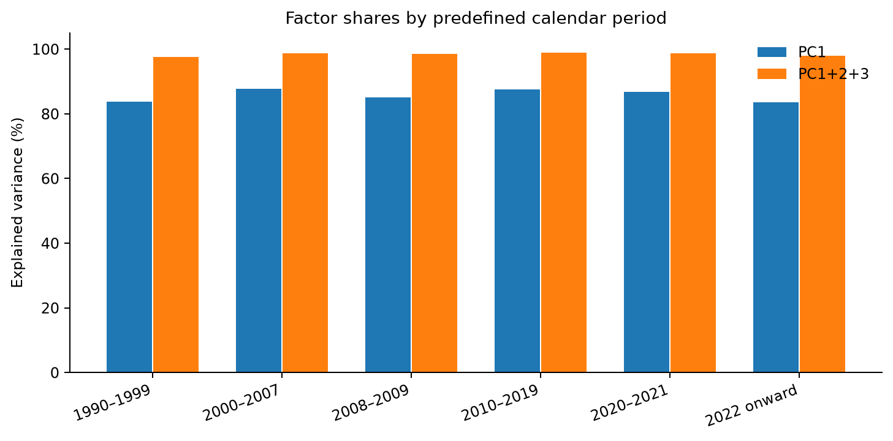
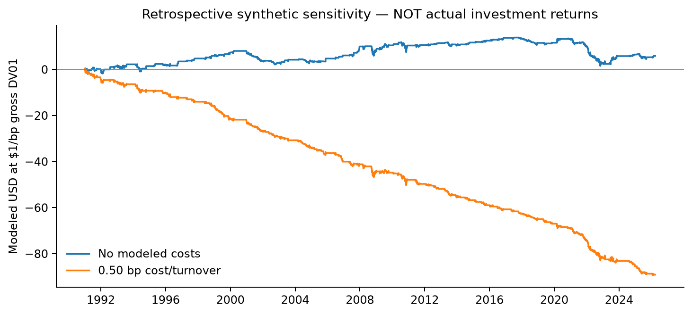
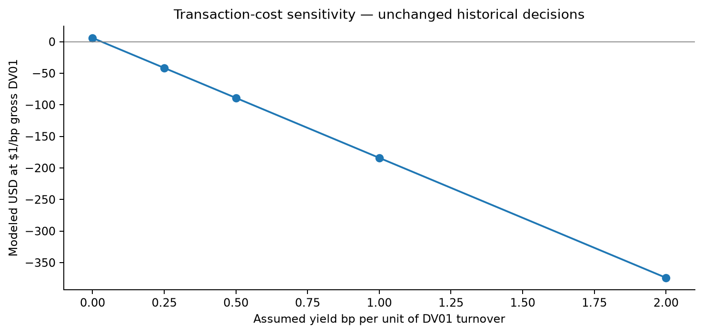

# U.S. Treasury Yield-Curve Factor Research — Historical Study

> **RESEARCH ONLY — NOT A TRADING BACKTEST.** The Federal Reserve daily-dated fitted yields are generally published weekly, typically on Tuesday through the previous Friday, and may be revised. The simulation delays daily observation rows, but does not reconstruct publication dates or data vintages. Consequently it cannot substantiate any investable return or live forecasting ability.

## Executive summary

- Dataset: 9,044 complete eight-tenor records, from 1990-01-02 to 2026-03-27.
- Full-sample daily-change PCA: PC1 83.9%, PC2 11.1%, PC3 2.8%; combined 97.9% explained variance.
- Synthetic risk-model eligible dates: 8,789; dates with held exposure: 3,894; entry events: 92.
- Net modeled sensitivity at 0.25 bp cost per unit turnover: -41.61 USD per assumed $1/bp gross DV01. This is **not actual bond P&L**.

## Source and fixed methodology

Data are Federal Reserve Gürkaynak–Sack–Wright nominal **fitted zero-coupon yields**, not executable Treasury note prices.
- Source file: 16,903 observations through 2026-03-27. SHA-256: e43e550f1c4e360512c455096cfe350a5737129a8c51147b8803fe383a114539.
- Fixed sample begins 1990-01-01, dropping observations missing any of 1/2/3/5/7/10/20/30Y fitted points.
- Descriptive PCA: three components on unscaled eight-maturity **daily yield changes** (percentage points); sign is arbitrary.
- Synthetic scenario: separate 5Y–7Y–10Y rolling PCA minimum-variance fly constructed from prior daily observations.
- Backtest settings fixed before results: 252-observation PCA, 126-observation z-history, |entry z|=2.0, |exit z|=0.5, gross risk of $1 per bp DV01.
- All scenarios share the same positions; cost is a stylized bp-of-yield charge on modeled DV01 turnover.
- The last 30% calendar slice in the underlying implementation is **not** treated as a genuinely untouched holdout.

## Historical factors

## Descriptive period comparisons

| Period | PCA observations | PC1 % | PC1–3 % | Eligible days | Held % | Entries | Gross $ | Net $ @0.25bp | Net $ @1bp |
|---|---:|---:|---:|---:|---:|---:|---:|---:|---:|
| 1990–1999 | 2,482 | 83.8 | 97.7 | 2,228 | 36.8 | 28 | 7.37 | -7.05 | -50.30 |
| 2000–2007 | 2,000 | 87.7 | 98.7 | 2,000 | 45.7 | 22 | 2.60 | -8.56 | -42.04 |
| 2008–2009 | 501 | 85.1 | 98.6 | 501 | 45.5 | 4 | 0.47 | -1.57 | -7.69 |
| 2010–2019 | 2,501 | 87.5 | 98.9 | 2,501 | 43.9 | 23 | 1.14 | -10.53 | -45.54 |
| 2020–2021 | 502 | 86.7 | 98.7 | 502 | 61.6 | 5 | -1.38 | -4.22 | -12.74 |
| 2022 onward | 1,057 | 83.7 | 97.9 | 1,057 | 49.6 | 10 | -4.32 | -9.68 | -25.77 |

Amounts are **synthetic modeled dollars** normalized to $1/bp gross DV01, NOT actual investment dollars, a percentage return, or tradable strategy performance.

## Transaction cost sensitivity

| Hypothetical cost (bp) | Gross sensitivity | Cost penalty | Net sensitivity |
|---:|---:|---:|---:|
| 0.00 | 5.88 | 0.00 | 5.88 |
| 0.25 | 5.88 | 47.49 | -41.61 |
| 0.50 | 5.88 | 94.99 | -89.10 |
| 1.00 | 5.88 | 189.97 | -184.09 |
| 2.00 | 5.88 | 379.94 | -374.06 |

## What this does and does not establish

1. The retrospective sample reveals covariance structure in U.S. Treasury fitted yields. PCA sign and shape can change across decades; its factors are not standalone alpha.
2. The three-tenor hypothetical fly is not a portfolio of specified CUSIPs. Real bond prices, coupon carry, roll, financing, convexity, spreads, slippage, and borrow are excluded.
3. **Crucial timing caveat:** Two observation rows of delay do not handle the Fed's weekly posting schedule or historical data revisions; the experiment is not point-in-time investable.
4. Comparisons across fixed calendar eras are descriptive, not regime-causal claims; no test was pre-registered and no untouched out-of-sample confirmation is asserted.
5. The transaction cost levels are **assumptions**, not empirically collected market quotes. Sensitivity is in hypothetical dollars normalized to $1/bp gross DV01, not Sharpe/ROI.

## Reproduce

~~~bash
python -m pip install -r requirements-dev.txt
python -m pip install matplotlib reportlab
python -m scripts.generate_historical_study --data feds200628.csv --output research/historical_study
~~~

This command recreates this report, the figures, results.json, modeled daily sensitivity and REPORT.pdf without accessing a broker.

### Primary source

- Federal Reserve Board, [Nominal Yield Curve](https://www.federalreserve.gov/data/nominal-yield-curve.htm): methods, fitted-data vintage and weekly publication FAQ.
- Gürkaynak, Sack and Wright, *The U.S. Treasury Yield Curve: 1961 to the Present* (FEDS 2006-28).
